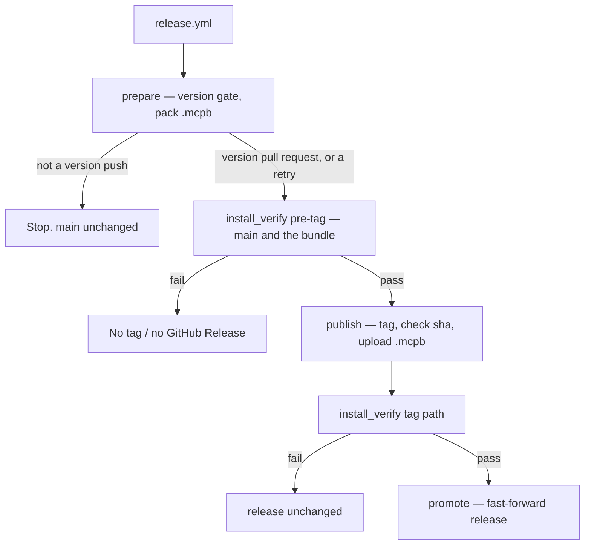

# Maintainer guide — releases & CI

Instructions for **maintainers of this repository** who cut releases and manage versioning.

Developers should read **[DEVELOPMENT.md](DEVELOPMENT.md)**. End users should read **[README.md](README.md)**.

For install-verify CI details (scripts, logs, triggers), see **[TESTING.md](TESTING.md)**.

---

## Versioning at a glance

The version number format is `x.y.z`; tags are named `v{x.y.z}` — e.g. shipping version `0.1.42` creates tag `v0.1.42`.

| Part | Meaning | Who changes it |
|------|---------|----------------|
| **`x.y`** (major.minor line) | e.g. `0.1` in `0.1.42` | A maintainer, by editing the version files in a version pull request |
| **`z`** (patch) | e.g. `42` in `0.1.42` | A maintainer, via `bump-package-z.sh` on a branch |

The version is stored in `package.xml`,
`mcp-stdio-shim/manifest.json`, and
`mcp-stdio-shim/package.json`. A version pull request changes
only those files. `bump-package-z.sh` writes the next patch into
all three, and the date in `package.xml`. A new major or minor
line is the same pull request with those files edited by hand.
The maintainer commits the files and opens the pull request.
The script does not commit or push.

The release workflow pushes nothing to `main`. The next version
is another version pull request. Between releases, `main` holds
whatever those pull requests leave there; see
[Branches, tags, and the FreeCAD Addon Index](#branches-tags-and-the-freecad-addon-index).

---

## Why these rules exist

- **Tags are permanent.** A tag names a fixed install source — once `v{x.y.z}` exists, its content must never change, or every install/reference pointing at it silently breaks.
- **Every component in a release carries the same version.** Matching numbers across `package.xml`, `manifest.json`, and `package.json` are what make "version X" mean one coherent thing, not a mismatched patchwork.
- **Version numbers only increase.** A newer version must always sort higher than an older one, or "is this an update" becomes unanswerable — for Addon Manager, for users, for anyone comparing releases.
- **The release pipeline is automated and gated, to help ensure the above.**
- **What we verify is what we tag.** The prepare job pins the release-candidate commit; publish refuses to tag if `main` has moved since; the tag is then re-verified by installing it, and only then does `release` move. The Addon Index listing, which follows `release`, can therefore never point at an untested snapshot.
- **`release` only moves forward.** Promote pushes without force, so GitHub refuses any move that isn't a fast-forward; what Index users already have is never rewritten.
- **The tag's zip is the tag.** GitHub archives the same tree the tag names, so the two install forms can never differ in content — only in install-layout mechanics. Verifying the zip form is about layout handling, never a second content gate.

---

## Release tags

**Releases** are created by the **release orchestrator workflow** (`release.yml`). It produces a verified snapshot: install-verify green on three OSes, then tag (with release notes on GitHub), then a second install-verify from the tag, then the **`release`** branch moves to that commit. Manual tags are fine for experiments or other uses; only **`release.yml`** moves `release`.

**FreeCAD Addon Index Qualities:** A listed `git_ref` must point at a complete, installable snapshot per the [FreeCAD Addon Index Qualities](https://freecad.github.io/Addon-Academy/Topics/Addon-Index/Index/Qualities.html) — Python sources and `package.xml`, nothing else required. The addon ships no prebuilt binaries at all; verify runs before the tag specifically to confirm the snapshot actually installs.

---

## Branches, tags, and the FreeCAD Addon Index

* **`main`** is the development branch. It may be ahead of the latest shipped release.
* **`release`** is the latest verified release. Only `release.yml` moves it, and only forward (a plain push, never forced), so undoing a bad release means shipping a new one.
* **Version tags** (`v{x.y.z}`) mark each release's commit, for history and the GitHub Release with its `.mcpb`.
* Listed on the [FreeCAD Addon Index](https://github.com/FreeCAD/Addons) as **`freecad-mcp-bridge`** with `git_ref` **`release`**: Index users follow `release`, and a release reaches them without an Index PR.

---

## When `package.xml` updates

A version pull request is the only change to the version. It
changes `package.xml`, `mcp-stdio-shim/manifest.json`, and
`mcp-stdio-shim/package.json`, and nothing else. Merging it
starts the release.

`package.xml`'s repository url names branch **`release`**: the Addon Manager installs that branch rather than the Index's `git_ref`, so the two must agree. **prepare** refuses to run otherwise. The Addon Manager offers an update when the `<version>` on `release` changes, which every release does.

---

### Workflows

| Name | File | Role |
|------|------|------|
| **Release orchestrator workflow** | [`release.yml`](.github/workflows/release.yml) | Ships a version when a version pull request merges. Actions UI: **Release Orchestrator** → Run workflow, to retry a release that failed after that merge. |
| **Install-verify workflow** | [`install-verify.yml`](.github/workflows/install-verify.yml) | Confirms addon installation works on Linux, macOS, and Windows. Can be run at any time; `release.yml` calls it before tag (`main`) and after (`tag` path). Actions UI: **Install verify**. |

---

## The release orchestrator workflow (`release.yml`)

A push to `main` starts the release orchestrator. Prepare
releases that push only when `package.xml`'s version differs from
the previous tip and the push changes only the three version
files. Any other push stops there. **Run workflow** is the retry
for a release that failed after its version merged: it ships the
current `main` when that version's tag does not exist yet. The
workflow then tags the commit, runs install-verify before and
after the tag, and moves `release`. It pushes nothing to `main`.

**`release.yml` job order:**

1. **Prepare** — on a push, compare `package.xml`'s version with
   the previous tip (`github.event.before`) and fail the run
   unless its diff is only the three version files. On **Run
   workflow**, take the current `main`. Then resolve the version,
   verify the tag does not already exist, validate the Claude
   Desktop bundle manifest (`mcpb validate`), record the
   release-candidate commit SHA, pack `freecad-mcp-bridge.mcpb`,
   record its sha256, and upload that file.
2. **Install-verify** (pre-tag) —
   [`install-verify.yml`](.github/workflows/install-verify.yml)
   with `install_mode: main` and `verify_bundle: true`: full
   Addon Manager install and restart verify on all three OSes
   against `main`, then the packed shim called over stdio while
   that bridge is still up. **No tag if this fails.**
3. **Publish** — push the matching tag (`v{x.y.z}`) on the
   verified commit, create a **GitHub Release**, check the
   packed bundle's sha256, and upload that same file. Uses
   [`release-publish-orchestrator.sh`](scripts/release-publish-orchestrator.sh)
   (`RELEASE_PUBLISH_AUTHORIZED=true`; not runnable standalone).
4. **Install-verify** (tag path) — same workflow with
   `install_mode: tag`: final sanity check that install works
   from the tag ref. **`release` does not move if this fails.**
5. **Promote** — push the verified commit to **`release`** as a plain push, which GitHub refuses unless it fast-forwards. This is the step that ships to Index users.

A push whose version is unchanged stops in prepare without
releasing. Running the workflow by hand while that version's tag
already exists fails at prepare.

---

## Release assets

Each GitHub Release carries one uploaded asset:
**`freecad-mcp-bridge.mcpb`** — the Claude Desktop bundle,
packed from `mcp-stdio-shim/` in prepare and attached, after
its sha256 matches, during publish. The addon itself isn't a
release asset — it ships as plain Python source, installed
directly from the repo tree (via the tag or its zip), not
from anything attached to the release page.

---

## Shipping a release (checklist)

1. On a branch, run
   [`scripts/bump-package-z.sh`](scripts/bump-package-z.sh),
   or edit the three version files to the version you intend
   to ship. The files are `package.xml`,
   `mcp-stdio-shim/manifest.json`, and
   `mcp-stdio-shim/package.json`.
2. Open a pull request that changes only those files. It runs
   every test a pull request runs.
3. Merge it. `release.yml` tags that commit, verifies it, and
   moves `release`. It does not push to `main`.
4. If that run fails after the merge, GitHub → **Actions** →
   **Release Orchestrator** → **Run workflow**, on `main`.
   That retries the current `main`. Index users get the
   release once the FreeCAD Addon Index cache refreshes,
   which can take up to **four hours**.

**Duplicate versions are blocked.** **`release.yml`** reads
`package.xml`, checks that `v{x.y.z}` does not already exist
(**prepare**), and **publish** checks again before tagging. If
the tag is already on GitHub, the run fails. No second tag, no
partial publish. A push that does not change the version does
not release. The next version is another version pull request.

---

## FreeCAD Addon Index

How **this repo's maintainers** update the **`freecad-mcp-bridge`** listing on the FreeCAD Addon Index. **FreeCAD Addon Index maintainers** (the [FreeCAD/Addons](https://github.com/FreeCAD/Addons) team) review and merge changes to [`Data/Index.json`](https://github.com/FreeCAD/Addons/blob/master/Data/Index.json) on FreeCAD/Addons — not in this repository — a different maintainer role.

Guides: [Updating](https://freecad.github.io/Addon-Academy/Guides/Maintaining/Updating), [FreeCAD Addon Index Qualities](https://freecad.github.io/Addon-Academy/Topics/Addon-Index/Index/Qualities.html).

The entry lists `git_ref` **`release`** with `zip_url` `https://github.com/CREATeNG/freecad-mcp-bridge/archive/refs/heads/release.zip`. It changes only if the branch name does; releases need no Index PR.

The FreeCAD Addon Index cache refreshes from `release` periodically, which can take up to **four hours**.

---

## Automated install verification (CI)

See **[TESTING.md](TESTING.md)** for the full CI architecture: triggers, install vs verify phases, `ci_run_freecad.sh`, CI log format, and GitHub annotation behavior.

Summary: **`install-verify.yml`** runs `test_install.py` and `test_verify.py` in **two separate FreeCAD processes** per OS (bash launcher on all platforms). See [TESTING.md](TESTING.md) for trigger and mode details.